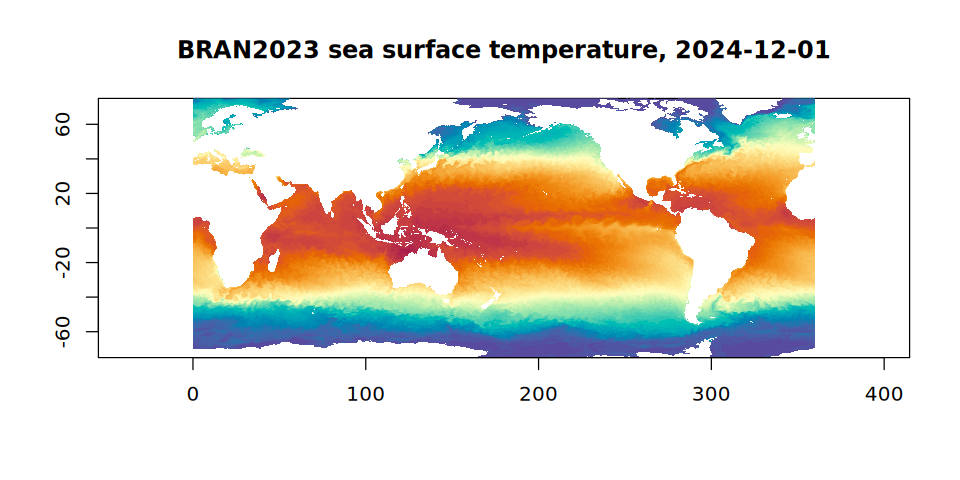

# One array, two virtualisations: mosaic VRT and virtual references

A model run is usually published as many files: one per month, each
holding that month’s days of a four-dimensional array. To analyse the
run, those files have to be seen as the one array they were cut from.
There are two ways to do that without copying any data, and GDAL reads
both:

- a **mosaic**: a multidimensional VRT, written by `gdal mdim mosaic`,
  that says which file holds which part of the array and leaves GDAL to
  open the files and read them with the netCDF driver;
- **virtual references**: a Zarr store whose chunks are not stored but
  pointed at, each as a URL, an offset and a length into one of the
  original files. The pointers come from reading the files’ internal
  chunk index once, and GDAL reads them with the Zarr driver.

Both end with a `GDALMDArray`, and the values are the same bytes. This
article builds both for the same array and compares them. It follows the
[virtualized](https://github.com/mdsumner/virtualized) repository, which
holds virtual references for the Bluelink reanalysis.

## The data

[BRAN2023](https://research.csiro.au/bluelink/global/reanalysis/) is
CSIRO’s Bluelink ocean reanalysis: a global 0.1 degree ocean model run,
daily. Its potential temperature is published on NCI’s THREDDS server as
one netCDF-4 file per month, each `(Time, st_ocean, yt_ocean, xt_ocean)`
with the days of the month, 51 depths, 1500 latitudes and 3600
longitudes, stored as packed 16-bit integers in chunks of one day, one
depth and 300 by 300 cells.

THREDDS serves each file over plain HTTP with range requests, so
`/vsicurl/` reads just the parts of a file it needs. At NCI the same
files are on disk under `/g/data/gb6/BRAN/BRAN2023/daily`, and nothing
below changes but the directory, so it is read from the `BRAN_DAILY`
environment variable with THREDDS as the default. It says where this
article was built:

``` r

library(GDAL7)

bran <- Sys.getenv(
  "BRAN_DAILY",
  "/vsicurl/https://thredds.nci.org.au/thredds/fileServer/gb6/BRAN/BRAN2023/daily"
)
month_file <- function(year, month) {
  sprintf("%s/ocean_temp_%d_%02d.nc", bran, year, month)
}
bran
#> [1] "/g/data/gb6/BRAN/BRAN2023/daily"
```

Over THREDDS, two settings keep GDAL from asking the server for things
that are not there: a directory listing of THREDDS’s file area, and the
sidecar files (`.aux.xml`, `.aux` and the rest, in several cases) that
GDAL looks for beside any file it opens and would otherwise ask THREDDS
for, one request each. On disk they cost nothing either way.

``` r

gdal_config("GDAL_DISABLE_READDIR_ON_OPEN", "EMPTY_DIR")
gdal_config("GDAL_PAM_ENABLED", "NO")
```

## Route one: a mosaic VRT

`gdal mdim mosaic` opens each input, checks that they hold the same
array with the same dimensions, and works out where each one goes from
its coordinate variables. Two months are enough to show it:

``` r

inputs <- c(month_file(2024, 11), month_file(2024, 12))
vrt <- file.path(tempdir(), "bran-temp.vrt")
gdal_run("mdim mosaic", list(input = inputs, output = vrt, array = "temp"),
         progress = FALSE)
file.size(vrt)
#> [1] 5977
```

The VRT is a few kilobytes of XML. It describes the array and says which
file holds which days; there are no values in it:

``` r

xml <- readLines(vrt)
trimws(grep("SourceFilename|DestSlab", xml, value = TRUE))
#> [1] "<SourceFilename>/g/data/gb6/BRAN/BRAN2023/daily/ocean_temp_2024_11.nc</SourceFilename>"
#> [2] "<DestSlab offset=\"0,0,0,0\" />"                                                       
#> [3] "<SourceFilename>/g/data/gb6/BRAN/BRAN2023/daily/ocean_temp_2024_12.nc</SourceFilename>"
#> [4] "<DestSlab offset=\"30,0,0,0\" />"
```

It opens like any other multidimensional dataset:

``` r

mosaic_ds <- gdal_open(vrt, multidim = TRUE)
mosaic <- open_mdarray(get_root_group(mosaic_ds), "temp")
mosaic@dimensions
#>       name size         type direction indexed
#> 1     Time   61     TEMPORAL              TRUE
#> 2 st_ocean   51     VERTICAL      DOWN    TRUE
#> 3 yt_ocean 1500 HORIZONTAL_Y              TRUE
#> 4 xt_ocean 3600 HORIZONTAL_X              TRUE
mosaic@block_size
#>     Time st_ocean yt_ocean xt_ocean 
#>        1        1      300      300
```

The mosaic needed every file opened once to be built: over THREDDS a
range request or two per file for its header, which for the whole run is
180 files. After that, a read opens only the files it touches.

## Route two: virtual references

The virtualized repository holds a [kerchunk
Parquet](https://fsspec.github.io/kerchunk/spec.html#parquet-references)
reference store for the same variable, built with VirtualiZarr on NCI
from the files in place, and then pointed at the THREDDS URLs. It covers
the whole run, not two months. GDAL’s Zarr driver reads a kerchunk
Parquet store directly (it needs GDAL’s Parquet driver to read the
references), and GitHub serves the store’s files over HTTP like any
other. At NCI, `BRAN_REFS` names a store whose references point at the
files on disk instead, as the store was before its paths were renamed:

``` r

refs_store <- Sys.getenv(
  "BRAN_REFS",
  paste0("/vsicurl/https://raw.githubusercontent.com/mdsumner/virtualized/",
         "refs/heads/main/remote/ocean_temp_2023.parq")
)
refs_ds <- gdal_open(sprintf('ZARR:"%s"', refs_store), multidim = TRUE)
refs_root <- get_root_group(refs_ds)
refs_root@mdarray_names
#>  [1] "Time"           "Time_bnds"      "average_DT"     "average_T1"    
#>  [5] "average_T2"     "nv"             "st_edges_ocean" "st_ocean"      
#>  [9] "temp"           "xt_ocean"       "yt_ocean"

refs <- open_mdarray(refs_root, "temp")
refs@dimensions
#>       name size type direction indexed
#> 1     Time 5479                   TRUE
#> 2 st_ocean   51                   TRUE
#> 3 yt_ocean 1500                   TRUE
#> 4 xt_ocean 3600                   TRUE
refs@block_size
#>     Time st_ocean yt_ocean xt_ocean 
#>        1        1      300      300
```

The chunk shape is the netCDF files’ own, because each Zarr chunk is one
of their chunks. Opening read the store’s metadata and none of the
netCDF files.

## The same bytes

Pick a day, a depth and a latitude, and read every longitude, from each
route. The two arrays cover different stretches of time, so the day is
found by its value rather than its position. Time is in days since
1979-01-01, at noon:

``` r

day <- as.numeric(as.Date("2024-12-01") - as.Date("1979-01-01")) + 0.5
mosaic_t <- match(day, mosaic@dimension_values$Time)
refs_t <- match(day, refs@dimension_values$Time)
c(mosaic = mosaic_t, refs = refs_t)
#> mosaic   refs 
#>     31   5449
```

Depth 11 and latitude 101, counting from 1, are the `st_ocean = 10` and
`yt_ocean = 100` of the xarray example in the virtualized README:

``` r

from_mosaic <- read_mdarray(mosaic, start = c(mosaic_t, 11, 101, 1),
                            count = c(1, 1, 1, 3600), nodata_as_na = FALSE)
from_refs <- read_mdarray(refs, start = c(refs_t, 11, 101, 1),
                          count = c(1, 1, 1, 3600), nodata_as_na = FALSE)
identical(as.vector(from_mosaic), as.vector(from_refs))
#> [1] TRUE
```

Identical, as they must be: both read the same compressed chunks of the
same file, one through the netCDF library and one by byte range.
`nodata_as_na = FALSE` keeps the comparison to the bytes themselves;
what each route treats as nodata comes from its metadata, the netCDF
`_FillValue` on one side and the Zarr `fill_value` on the other:

``` r

c(mosaic = mosaic@nodata_value, refs = refs@nodata_value)
#> mosaic   refs 
#> -32768 -32767
```

They differ by one. The netCDF files say their fill value is -32768, and
the reference store, written by another tool, says -32767. Only one can
be what the land cells hold, and the map below shows which. With
`nodata_as_na = TRUE`, the default, the two routes would give different
answers for the same bytes: one would turn the land into `NA` and the
other would read it as a temperature of about -10 degrees.

The values are the stored 16-bit integers; the scale and offset turn
them into degrees:

``` r

c(scale = refs@scale, offset = refs@offset)
#>       scale      offset 
#> 7.78222e-03 2.45000e+02
celsius <- as.vector(from_refs) * refs@scale + refs@offset
head(celsius)
#> [1] -1.540727 -1.532945 -1.525162 -1.540727 -1.548509 -1.548509
```

The README’s xarray read of the same cells gives
`-1.54072672, -1.5329445, -1.52516228, ...`.

## What differs

The values do not, and neither does the chunk shape. The rest does.

**What reading costs.** A read through the mosaic opens the netCDF files
it needs, which means reading each one’s HDF5 header and chunk index
over HTTP, and then reads the chunks. A read through the references
looks the chunks up in the Parquet table and asks for their byte ranges
directly; the HDF5 index was read once, when the references were made.

**What building costs.** The mosaic needs only GDAL and the files, and
its build reads every file’s header. The references need a tool that
understands the file format’s internals (VirtualiZarr or kerchunk in
Python, or rhdf5 and GDAL as in the repository’s `zarr/` stores) and a
pass over every file.

**Size.** The VRT grows by a few lines per file. The references are one
row per chunk: for this variable that is 5479 days by 51 depths by 60
tiles, about 17 million rows, which is why they are stored as Parquet
rather than JSON.

**Metadata.** The mosaic carries the netCDF driver’s reading of each
file, so its dimensions have types and its fill value is the files’ own;
the reference store has what was written into its Zarr metadata, and no
more:

``` r

data.frame(name = mosaic@dimensions$name,
           mosaic = mosaic@dimensions$type,
           refs = refs@dimensions$type)
#>       name       mosaic refs
#> 1     Time     TEMPORAL     
#> 2 st_ocean     VERTICAL     
#> 3 yt_ocean HORIZONTAL_Y     
#> 4 xt_ocean HORIZONTAL_X
```

## As a map

Either array is a `GDALMDArray`, so the rest of GDAL7 applies. A view
takes one day at one depth,
[`advise_read()`](https://rgdal-dev.github.io/GDAL7/reference/advise_read.md)
fetches its 60 chunks on GDAL’s threads, and
[`as_classic_dataset()`](https://rgdal-dev.github.io/GDAL7/reference/as_classic_dataset.md)
gives the slice a geotransform from its coordinates. The slice is read
as stored, and counting the cells that hold each fill value settles
which one is real:

``` r

surface <- get_view(refs, sprintf("[%d,0,:,:]", refs_t - 1))
advise_read(surface, start = c(1, 1), count = c(1500, 3600))
stored <- read_mdarray(surface, nodata_as_na = FALSE)
c(netcdf = sum(stored == mosaic@nodata_value),
  zarr = sum(stored == refs@nodata_value))
#>  netcdf    zarr 
#> 1674736       0

stored[stored == mosaic@nodata_value] <- NA
sst <- stored * refs@scale + refs@offset
dim(sst)
#> xt_ocean yt_ocean 
#>     3600     1500

grid <- as_classic_dataset(surface)
grid@geotransform
#>        origin_x     pixel_width    row_rotation        origin_y column_rotation 
#>   -9.507305e-10    1.000000e-01    0.000000e+00   -7.500000e+01    0.000000e+00 
#>    pixel_height 
#>    1.000000e-01

gt <- grid@geotransform
lon <- gt[["origin_x"]] + (seq_len(dim(sst)[1]) - 0.5) * gt[["pixel_width"]]
lat <- gt[["origin_y"]] + (seq_len(dim(sst)[2]) - 0.5) * gt[["pixel_height"]]
image(lon, lat, sst, asp = 1, useRaster = TRUE,
      col = hcl.colors(64, "Spectral", rev = TRUE), xlab = "", ylab = "")
title("BRAN2023 sea surface temperature, 2024-12-01")
```



plot of chunk map

The cell centres come from the geotransform rather than from the
coordinate variables: those are stored as 32-bit floats, so their
spacing is not exactly regular, and
[`image()`](https://rdrr.io/r/graphics/image.html) draws a raster only
from a grid that is. The land is blank because it was masked with the
netCDF fill value. Latitude in BRAN runs from south to north, so the
first row of this raster is the southernmost and its pixel height is
positive.

## Next

The virtualized repository plans Icechunk stores for the same
references. Icechunk keeps virtual chunk references natively, as a URL,
an offset and a length per chunk, and adds versioning; GDAL reads them
through its Icechunk driver, which turns the URLs into `/vsicurl/` and
`/vsis3/` paths the same way. See
[Icechunk](https://rgdal-dev.github.io/GDAL7/articles/icechunk.md), and
[Multidimensional
arrays](https://rgdal-dev.github.io/GDAL7/articles/multidim.md) for the
functions used here.
